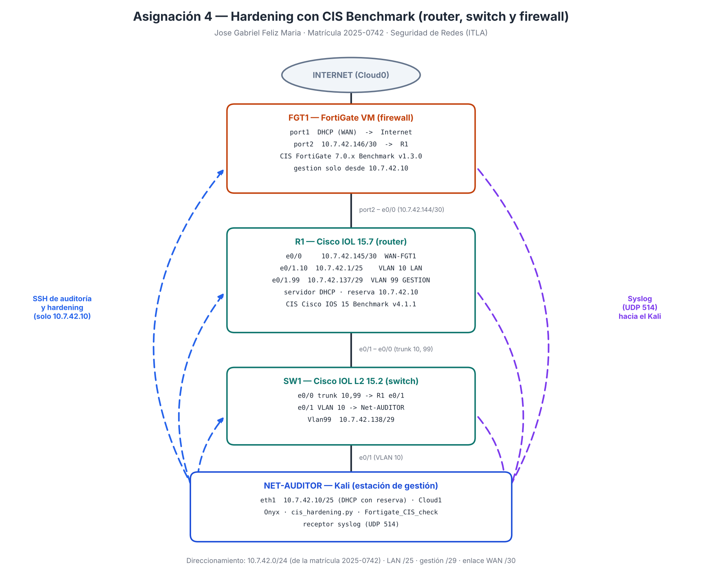
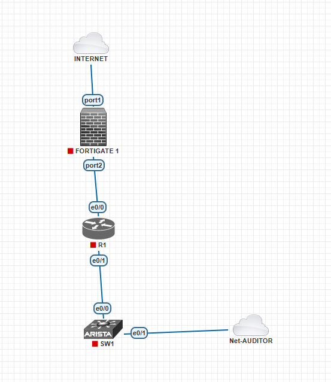
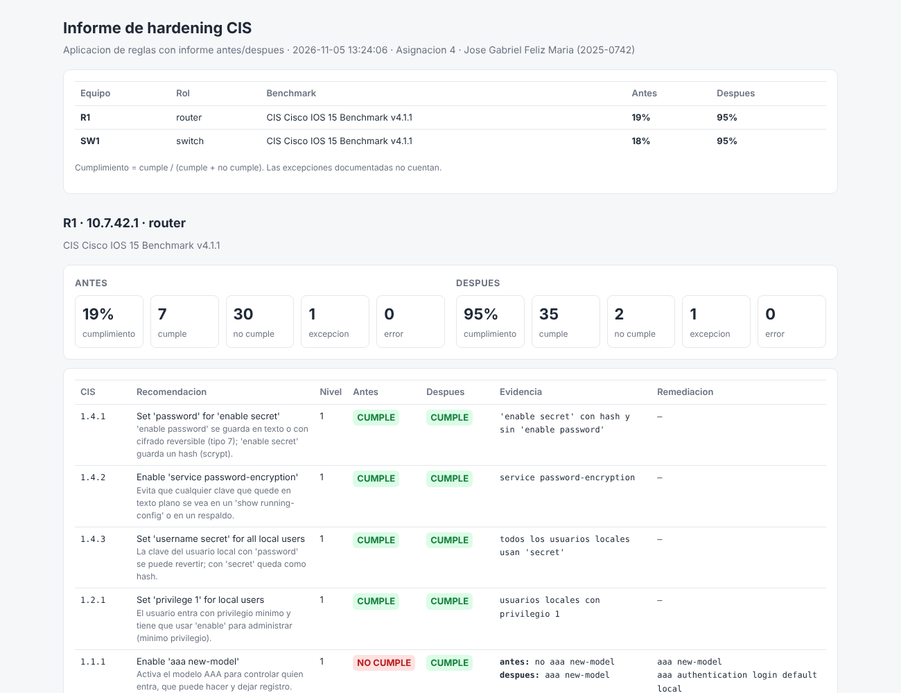
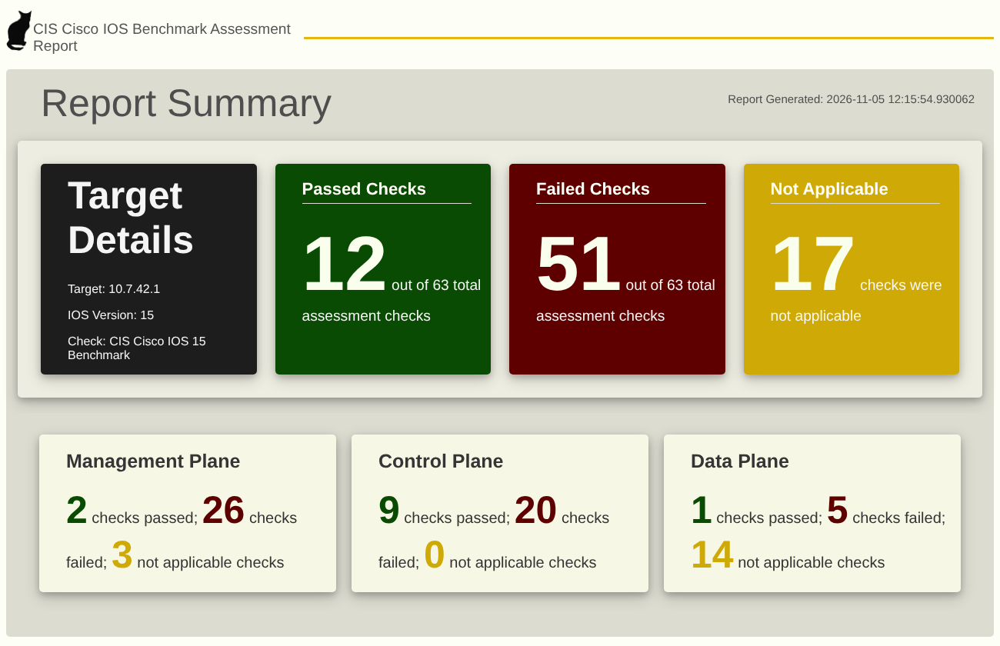
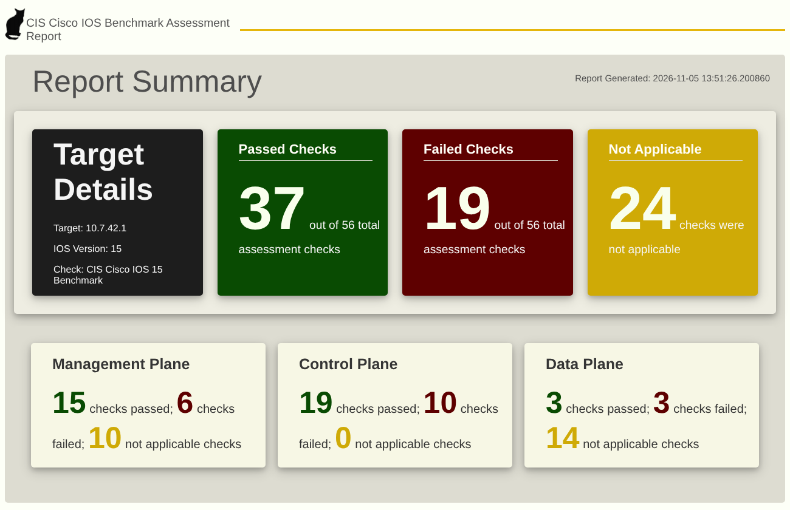
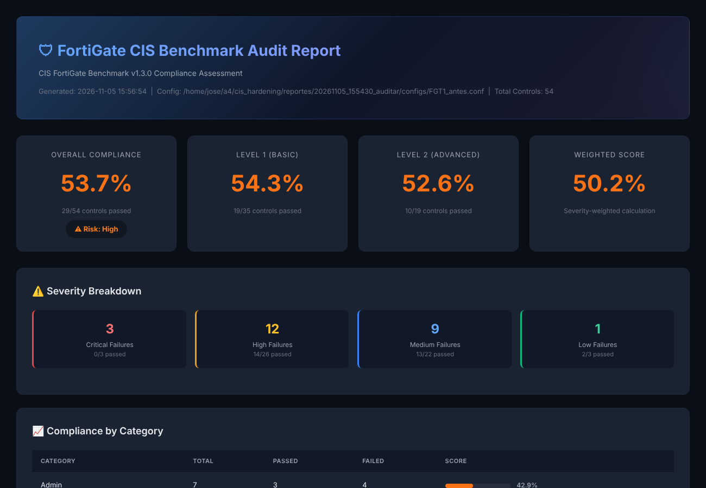
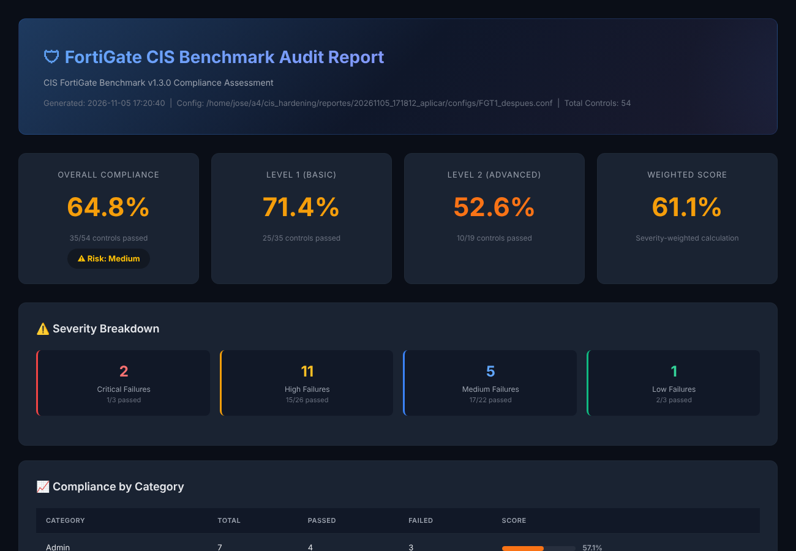
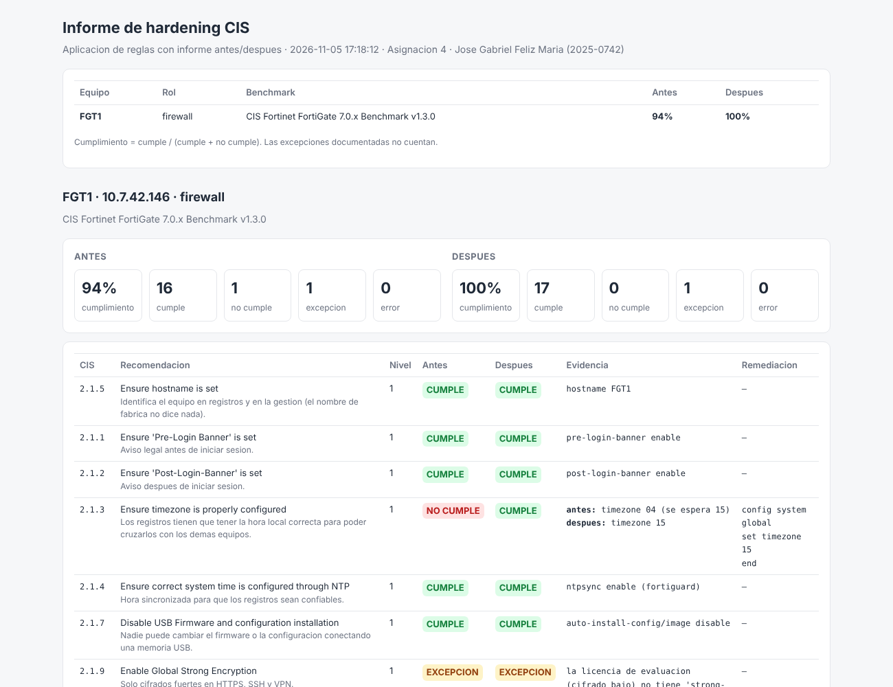

# Asignación 4 — Hardening de router, switch y firewall con CIS Benchmark

**Jose Gabriel Feliz Maria · Matrícula: 2025-0742**
**Seguridad de Redes · ITLA**

---

## 🎥 Video Demostrativo

**[Ver demostración en YouTube](PENDIENTE_LINK_VIDEO)**

En el video se muestra la hora y fecha del sistema, el rostro y la voz del autor, y la demostración de que la topología cumple su objetivo: se audita el router, el switch y el FortiGate contra el CIS Benchmark, el script corrige automáticamente las recomendaciones elegidas y genera el informe de antes y después, y las pruebas confirman que el hardening funciona (telnet cerrado, SSH solo desde la estación de gestión, banners, SNMP apagado, registros por syslog y administración del FortiGate cerrada hacia Internet).

---

## 📋 Tabla de Contenido

1. [Propósito del Laboratorio](#1-propósito-del-laboratorio)
2. [Topología](#2-topología)
3. [Direccionamiento IP](#3-direccionamiento-ip)
4. [Herramientas CIS Utilizadas](#4-herramientas-cis-utilizadas)
5. [Recomendaciones CIS Elegidas: Cisco IOS](#5-recomendaciones-cis-elegidas-cisco-ios)
6. [Recomendaciones CIS Elegidas: FortiGate](#6-recomendaciones-cis-elegidas-fortigate)
7. [Script `cis_hardening.py`](#7-script-cis_hardeningpy)
8. [Resultados Antes y Después](#8-resultados-antes-y-después)
9. [Pruebas Funcionales](#9-pruebas-funcionales)
10. [Hallazgos y Problemas Encontrados](#10-hallazgos-y-problemas-encontrados)
11. [Running-Configs e Informes](#11-running-configs-e-informes)
12. [Evidencias (Capturas)](#12-evidencias-capturas)
13. [Estructura del Repositorio](#13-estructura-del-repositorio)
14. [Notas y Limitaciones del Laboratorio](#14-notas-y-limitaciones-del-laboratorio)

---

## 1. Propósito del Laboratorio

Un equipo de red recién configurado "funciona", pero casi nunca es seguro: telnet abierto, claves en texto plano, SNMP con `public`, sin banners, sin registros. Los **CIS Benchmarks** son guías públicas, hechas por consenso de la industria, que dicen exactamente qué revisar y qué corregir en cada tipo de equipo. Este laboratorio usa esas guías para endurecer (**hardening**) una red pequeña con los tres equipos que pide la asignación:

| Pide la asignación | Cómo se cumple |
|---|---|
| Router, switch y firewall | **R1** (Cisco IOS), **SW1** (Cisco IOS L2) y **FGT1** (FortiGate VM) |
| Una herramienta que analice contra el CIS Benchmark | **Onyx: CAAAT** para Cisco IOS 15 y **Fortigate_CIS_check** para FortiGate, más el script propio |
| Aplicar las recomendaciones, documentarlas y probarlas | Secciones [5](#5-recomendaciones-cis-elegidas-cisco-ios) a [9](#9-pruebas-funcionales) |
| Script que escanee automáticamente las recomendaciones elegidas | [`scripts/cis_hardening/cis_hardening.py`](scripts/cis_hardening/cis_hardening.py) |
| Modo 1: crear el informe **sin aplicar** ninguna regla | `python3 cis_hardening.py auditar` |
| Modo 2: **aplicar** las reglas y generar el **informe posterior** | `python3 cis_hardening.py aplicar` |

La configuración inicial de los equipos se dejó **insegura a propósito** ([`scripts/configs-base/`](scripts/configs-base/)) para que el antes y el después se vean claramente.

---

## 2. Topología



Topología montada en PNETLab:



| Equipo | Rol |
|---|---|
| **FGT1** | FortiGate VM. Firewall perimetral: `port1` hacia Internet (Cloud0) y `port2` hacia R1. Benchmark: CIS Fortinet FortiGate 7.0.x v1.3.0 |
| **R1** | Router Cisco IOL 15.7. Enlace WAN con el FortiGate por `e0/0`, router-on-a-stick por `e0/1` para la VLAN 10 (LAN) y la VLAN 99 (gestión), servidor DHCP de la LAN. Benchmark: CIS Cisco IOS 15 v4.1.1 |
| **SW1** | Switch Cisco IOL L2. Trunk hacia R1 por `e0/0`, puerto de acceso VLAN 10 para el Net-AUDITOR por `e0/1`, IP de gestión en la VLAN 99. Benchmark: CIS Cisco IOS 15 v4.1.1 |
| **Net-AUDITOR** | VM Kali (`eth1`, VMnet2, nube Cloud1). Es la **estación de gestión**: el único equipo que puede administrar la red. Corre Onyx, Fortigate_CIS_check y el script, y recibe los registros por syslog |

---

## 3. Direccionamiento IP

Se usa `10.7.42.0/24`, sacado de la matrícula **2025-0742**.

| Red | Uso | Equipos |
|---|---|---|
| `10.7.42.0/25` | VLAN 10 — LAN | R1 `e0/1.10` `10.7.42.1` (gateway y DHCP) · Kali `10.7.42.10` (DHCP con reserva) |
| `10.7.42.136/29` | VLAN 99 — GESTION | R1 `e0/1.99` `10.7.42.137` · SW1 `Vlan99` `10.7.42.138` |
| `10.7.42.144/30` | Enlace WAN R1 ↔ FGT1 | R1 `e0/0` `10.7.42.145` · FGT1 `port2` `10.7.42.146` |
| DHCP del Cloud0 | Internet | FGT1 `port1` |

| Equipo | Rutas |
|---|---|
| R1 | `0.0.0.0/0` por `10.7.42.146` (FGT1) |
| SW1 | `ip default-gateway 10.7.42.137` |
| FGT1 | `10.7.42.0/24` por `10.7.42.145` (R1) · salida a Internet por `port1` |
| Kali | `10.7.42.128/25` por `10.7.42.1` (para llegar a la gestión y al WAN) |

---

## 4. Herramientas CIS Utilizadas

| Herramienta | Qué hace | Equipos |
|---|---|---|
| **[Onyx: CAAAT](https://github.com/UncleSocks/onyx-caaat-automated-cisco-ios-configuration-assessment-and-auditing-tool)** (UncleSocks) | Se conecta por SSH y revisa todo el **CIS Cisco IOS 15 Benchmark** (80 controles). Genera un informe HTML | R1 y SW1 |
| **[Fortigate_CIS_check](https://github.com/priyam001/Fortigate_CIS_check)** (priyam001) | Lee un respaldo de la configuración del FortiGate y lo compara con el **CIS FortiGate 7.0.x Benchmark v1.3.0** (56 controles). Genera HTML y JSON | FGT1 |
| **`cis_hardening.py`** (propio) | Revisa y **corrige** las recomendaciones elegidas para esta red, con informe antes/después | R1, SW1 y FGT1 |

Onyx y Fortigate_CIS_check son el auditor externo: revisan el benchmark completo y sirven para confirmar, con una herramienta que no es la mía, que el hardening mejoró el cumplimiento. El script propio es el que aplica los cambios.

Instalación de Onyx en el Kali (la versión nueva de `paramiko` no conecta con IOS 15, ver [hallazgo 1](#10-hallazgos-y-problemas-encontrados)):

```bash
git clone https://github.com/UncleSocks/onyx-caaat-automated-cisco-ios-configuration-assessment-and-auditing-tool.git ~/onyx
cd ~/onyx && python3 -m venv .venv && source .venv/bin/activate
pip install -r requirements.txt && pip install "paramiko<4"
cd src/onyx_unclesocks
python3 onyx.py -i -v 15 -o R1_antes.html      # -i = modo interactivo (pide IP, usuario y claves)
```

Instalación de Fortigate_CIS_check (la última versión publicada tiene un error que da 0 % siempre, ver [hallazgo 13](#10-hallazgos-y-problemas-encontrados); se usa la versión anterior `bfb4b44`):

```bash
git clone https://github.com/priyam001/Fortigate_CIS_check.git ~/fgtcis
cd ~/fgtcis && git checkout bfb4b44
python3 -m venv .venv && source .venv/bin/activate && pip install flask jinja2
# el respaldo FGT1_*.conf lo guarda cis_hardening.py en cada auditoria (con las claves tapadas)
python3 run_audit.py ruta/FGT1_antes.conf --format html,json --output-dir ~/a4/fgt_reportes/antes
```

---

## 5. Recomendaciones CIS Elegidas: Cisco IOS

Se eligieron **38 recomendaciones** del CIS Cisco IOS 15 Benchmark v4.1.1 que tienen sentido en esta red. Cada una está en [`reglas_ios.py`](scripts/cis_hardening/reglas_ios.py) con su forma de verificarla, el comando que la corrige y **por qué se aplica aquí** (ese texto también sale en el informe).

| Plano | Recomendaciones | Qué protege |
|---|---|---|
| **Gestión — claves** | 1.4.1 `enable secret` · 1.4.2 `service password-encryption` · 1.4.3 `username ... secret` · 1.2.1 `privilege 1` | Ninguna clave en texto plano ni reversible; el usuario entra con el mínimo privilegio |
| **Gestión — AAA** | 1.1.1 `aaa new-model` · 1.1.2 login · 1.1.3 enable · 1.1.4 consola · 1.1.6 vty | La consola y las líneas remotas piden usuario y clave con AAA |
| **Gestión — acceso** | 1.2.2 `transport input ssh` · 1.2.4 ACL de gestión · 1.2.5 `access-class` · 1.2.3 `no exec` en aux · 1.2.6–1.2.8 `exec-timeout` | Solo SSH, solo desde `10.7.42.10`, puerto aux cerrado y sesiones que se cierran solas a los 5 min |
| **Gestión — banners** | 1.3.1 exec · 1.3.2 login · 1.3.3 motd | Aviso legal de acceso restringido |
| **Gestión — SNMP** | 1.5.1 `no snmp-server` | En esta red no hay monitoreo: SNMP con `public` solo regala información |
| **Control — SSH** | 2.1.1.1.1 hostname · 2.1.1.1.2 dominio · 2.1.1.1.3 RSA ≥ 2048 · 2.1.1.1.4 timeout 60 s · 2.1.1.1.5 3 intentos · 2.1.1.2 SSH v2 | SSH fuerte, sin SSHv1 y con clave de 2048 bits |
| **Control — servicios** | 2.1.2 `no cdp run` · 2.1.3 `no ip bootp server` · 2.1.4 `no service dhcp` · 2.1.6/2.1.7 tcp-keepalives · 2.1.8 `no service pad` | Menos servicios expuestos y sesiones colgadas cerradas |
| **Control — registros** | 2.2.2 `logging buffered` · 2.2.3 `logging console critical` · 2.2.4 `logging host` · 2.2.7 `logging source-interface` | Los registros quedan en memoria y se envían al Kali por syslog |
| **Datos** | 3.1.1 `no ip source-route` · 3.1.2 `no ip proxy-arp` | Un paquete no elige su ruta y el router no responde ARP por otros |

### Excepciones documentadas

| CIS | Equipo | Por qué no se aplica igual que dice el benchmark |
|---|---|---|
| 2.1.4 `no service dhcp` | R1 | R1 es el **servidor DHCP** de la LAN (lo pide la red y el Kali recibe su IP por DHCP). Apagarlo dejaría la LAN sin IP. En SW1 sí se aplica |
| 2.2.7 `logging source-interface` | R1 y SW1 | El CIS sugiere una **Loopback**; aquí se usa la interfaz de gestión (R1 `Ethernet0/1.10`, SW1 `Vlan99`) porque la red no tiene Loopbacks (2.4.1 es de nivel 2 y no se eligió) y SW1 es un switch capa 2 |

### Recomendaciones del benchmark que no se eligieron

| CIS | Motivo |
|---|---|
| 1.1.7–1.1.11 AAA accounting · 2.4.2 AAA source-interface | Necesitan un servidor TACACS+/RADIUS; esta red usa la base local |
| 2.3.x NTP con autenticación | No hay servidor NTP en el laboratorio |
| 2.4.1, 2.4.3, 2.4.4 Loopback | Nivel 2; la red no usa Loopbacks |
| 3.1.4 uRPF · 3.2.1/3.2.2 ACL en la interfaz externa | Nivel 2; el borde con Internet lo protege el **FortiGate** |
| 3.3.x autenticación de OSPF, EIGRP, RIP, BGP | No hay protocolos de enrutamiento dinámico (Onyx los marca como *No aplica*) |

---

## 6. Recomendaciones CIS Elegidas: FortiGate

Se eligieron **18 recomendaciones** del CIS Fortinet FortiGate 7.0.x Benchmark v1.3.0, en [`reglas_fortios.py`](scripts/cis_hardening/reglas_fortios.py):

| CIS | Recomendación | Por qué en esta red |
|---|---|---|
| 2.1.5 | Hostname | El nombre de fábrica no identifica el equipo en los registros |
| 2.1.1 / 2.1.2 | Banner antes y después del login | Aviso legal de acceso restringido |
| 2.1.3 | Zona horaria | Los registros tienen que tener la hora local correcta |
| 2.1.4 | NTP | Hora sincronizada para que los registros sean confiables |
| 2.1.7 | Instalación por USB deshabilitada | Nadie cambia el firmware o la configuración con una memoria USB |
| 2.1.9 | `strong-crypto` | Solo cifrados fuertes en HTTPS y SSH |
| 2.1.10 | GUI solo con TLS 1.2 y 1.3 | Sin TLS 1.0/1.1 |
| 2.2.1 | Política de contraseñas | 12 caracteres, mayúscula, minúscula, número y símbolo, vence a los 90 días |
| 2.2.2 | Bloqueo por intentos fallidos | 3 intentos y bloqueo de 15 minutos |
| 2.4.2 | Trusted hosts | El administrador solo entra desde `10.7.42.10` |
| 2.4.4 | Tiempo de inactividad | La sesión se cierra a los 5 minutos |
| 2.4.5 | Solo canales cifrados | Sin HTTP ni Telnet para administrar |
| 2.4.7 | Puerto de administración cambiado | La GUI pasa del 443 al 8443 |
| 1.3 | Sin administración por el puerto WAN | Desde Internet no se llega a la administración |
| 3.2 | Políticas sin servicio `ALL` | La LAN sale solo por HTTP, HTTPS, DNS y ping |
| 3.4 | Políticas con registro | Todo el tráfico permitido queda registrado |
| 7.3.1 | Syslog | Los registros se envían al Kali |

### Versión y licencia

FGT1 corre **FortiOS 7.0.3** (`FortiGate-VM64-KVM v7.0.3, build0237`), la misma rama del benchmark (7.0.x). Usa la licencia de evaluación de 15 días que trae la 7.0 (vence el 20 de noviembre de 2026), con sus límites: **1 CPU**, 2 GB de RAM, **cifrado bajo** y máximo 3 políticas.

### Excepciones documentadas

| CIS | Por qué |
|---|---|
| 2.1.9 `strong-crypto` | La licencia de evaluación es de **cifrado bajo**: la opción `strong-crypto` no existe en esa compilación. El script la marca `EXCEPCION` en vez de darla por fallada |
| 2.4.7 puertos de administración | La GUI pasa del 443 al **8443**. SSH se deja en el 22 porque lo usan el script, Netmiko y las herramientas de auditoría, y ya está limitado por trusted host. HTTP no se mueve de puerto porque está **deshabilitado en todas las interfaces** |
| 2.1.3 zona horaria | Se usa la zona **15 — (GMT-4:00) La Paz**: República Dominicana es GMT-4 todo el año; "Atlantic Time (Canada)" también es GMT-4 pero cambia de hora en verano |

### Configuración base

[`FGT1_base_sin_hardening.txt`](scripts/configs-base/FGT1_base_sin_hardening.txt), insegura a propósito: HTTP y Telnet para administrar, administración abierta en el puerto WAN, política LAN → Internet con servicio `ALL` y sin registro, inactividad de 30 minutos, sin banners, sin trusted hosts, sin política de contraseñas, instalación por USB activa y sin syslog.

---

## 7. Script `cis_hardening.py`

### Modos

| Modo | Qué hace | ¿Cambia los equipos? |
|---|---|---|
| `auditar` | Se conecta por SSH, revisa cada recomendación elegida y genera el informe HTML y JSON | **No.** Solo envía comandos `show` |
| `aplicar` | Audita, muestra los comandos que corregirían cada punto que no cumple, **pide confirmación por equipo**, los aplica, guarda la configuración, se vuelve a conectar, audita otra vez y genera el informe **antes/después** | Sí, solo después de confirmar |
| `reglas` | Lista las recomendaciones que el script sabe revisar | No |

### Uso

```bash
cd scripts/cis_hardening
python3 -m venv .venv && source .venv/bin/activate
pip install -r requirements.txt

python3 cis_hardening.py reglas                    # lista de recomendaciones
python3 cis_hardening.py auditar                   # informe sin aplicar nada (todos los equipos)
python3 cis_hardening.py auditar -e R1,SW1         # solo esos equipos
python3 cis_hardening.py aplicar -e R1,SW1         # aplica y genera el informe antes/despues
python3 cis_hardening.py aplicar -e FGT1 --reglas 1.3,2.4.2   # solo esas recomendaciones
```

| Opción | Uso |
|---|---|
| `-i`, `--inventario` | Archivo con los equipos (por defecto [`inventario.json`](scripts/cis_hardening/inventario.json)) |
| `-e`, `--equipos` | Solo esos equipos, separados por coma |
| `-o`, `--salida` | Carpeta de los informes (por defecto `reportes/`) |
| `--reglas` | Solo esas recomendaciones CIS |
| `--sin-confirmar` | En `aplicar`, no pregunta antes de cada equipo |

Las claves se piden por teclado con `getpass` (no se ven ni quedan en el historial) o se leen de las variables `CIS_CLAVE_<GRUPO>` y `CIS_ENABLE_<GRUPO>`. **El inventario no tiene claves.**

### Cómo funciona

```
inventario.json ──► conectar (SSH con Netmiko) ──► recolectar
                                                   IOS: show running-config, show ip ssh,
                                                        show crypto key mypubkey rsa, show cdp
                                                   FortiOS: get system status + 8 secciones de
                                                        show full-configuration
        ┌──────────────────────────────────────────────┘
        ▼
   evaluar cada regla ──► CUMPLE / NO CUMPLE / EXCEPCION / ERROR + evidencia + comandos que la corrigen
        │
        ├── auditar: informe y fin
        └── aplicar: plan (sin repetir bloques) ─► confirmar ─► aplicar ─► write memory
                     ─► reconectar ─► evaluar otra vez ─► informe antes/despues
```

| Archivo | Contenido |
|---|---|
| [`cis_hardening.py`](scripts/cis_hardening/cis_hardening.py) | Programa principal: modos, credenciales, pantalla y carpeta de informes |
| [`nucleo.py`](scripts/cis_hardening/nucleo.py) | Estructura de una regla, estados, **ocultado de secretos** y lectura de configuraciones IOS y FortiOS |
| [`reglas_ios.py`](scripts/cis_hardening/reglas_ios.py) | Las 38 recomendaciones de Cisco IOS (verificación + corrección + motivo) |
| [`reglas_fortios.py`](scripts/cis_hardening/reglas_fortios.py) | Las 18 recomendaciones de FortiGate |
| [`motor.py`](scripts/cis_hardening/motor.py) | Conexión SSH, recolección, evaluación, plan y aplicación |
| [`informe.py`](scripts/cis_hardening/informe.py) | Informes HTML (autocontenido, modo claro y oscuro) y JSON |
| [`inventario.json`](scripts/cis_hardening/inventario.json) | Equipos y parámetros de la red (estación de gestión, syslog, banner) |

### Seguridad del propio script

- **Sin claves en ningún archivo.** Todo lo que se guarda o se muestra pasa por `ocultar()`, que tapa `password`, `secret`, `community`, `key`, los `ENC` de FortiOS y las claves que se escribieron en la sesión. Los informes y las configuraciones del repositorio salieron así del script.
- **Confirmación por equipo** antes de aplicar, mostrando la lista exacta de comandos.
- **Orden seguro:** primero las claves (`enable secret` y el usuario con `secret`), después AAA, al final la clave RSA. Si el usuario no queda bien creado, el script **se detiene antes de activar AAA** para no dejar el equipo sin acceso ([hallazgo 3](#10-hallazgos-y-problemas-encontrados)).
- **Antes de activar la política de contraseñas del FortiGate (2.2.1)** revisa que la clave actual del admin la cumpla; si no, omite esa regla y avisa, para no dejar el equipo pidiendo cambio de clave ([hallazgo 15](#10-hallazgos-y-problemas-encontrados)).
- En el FortiGate el nombre del equipo se cambia **al final**, porque al cambiarlo cambia el prompt de la sesión SSH.
- **Idempotente:** si se corre `aplicar` otra vez, no hay nada que corregir y no envía nada.
- Una regla que falla al verificarse queda como `ERROR` en el informe y no detiene el escaneo; un equipo que no responde no detiene a los demás.

Antes de usarlo en el laboratorio se probó con equipos simulados (un Netmiko falso que imita IOS y FortiOS) para comprobar el antes/después, que no se filtren claves y que el freno de seguridad funcione.

---

## 8. Resultados Antes y Después

### Script propio (38 recomendaciones IOS)

| Equipo | Antes ([informe](reportes/script/01_auditoria_inicial/informe_cis.html)) | Después ([informe](reportes/script/05_auditoria_final/informe_cis.html)) |
|---|---|---|
| **R1** | **8 %** — 3 cumple · 34 no cumple · 1 excepción | **100 %** — 37 cumple · 0 no cumple · 1 excepción |
| **SW1** | **8 %** — 3 cumple · 35 no cumple | **100 %** — 38 cumple · 0 no cumple |
| **FGT1** (18 recomendaciones) | **12 %** — 2 cumple · 15 no cumple · 1 excepción ([informe](reportes/script/06_fgt_auditoria_inicial/informe_cis.html)) | **100 %** — 17 cumple · 0 no cumple · 1 excepción ([informe](reportes/script/09_fgt_aplicar_zona_horaria/informe_cis.html)) |

Cumplimiento = cumple ÷ (cumple + no cumple). Las excepciones documentadas no cuentan.

| CIS | Recomendación | Nivel | R1 antes → después | SW1 antes → después |
|---|---|---|---|---|
| `1.4.1` | Set 'password' for 'enable secret' | 1 | ❌ → ✅ | ❌ → ✅ |
| `1.4.2` | Enable 'service password-encryption' | 1 | ❌ → ✅ | ❌ → ✅ |
| `1.4.3` | Set 'username secret' for all local users | 1 | ❌ → ✅ | ❌ → ✅ |
| `1.2.1` | Set 'privilege 1' for local users | 1 | ❌ → ✅ | ❌ → ✅ |
| `1.1.1` | Enable 'aaa new-model' | 1 | ❌ → ✅ | ❌ → ✅ |
| `1.1.2` | Enable 'aaa authentication login' | 1 | ❌ → ✅ | ❌ → ✅ |
| `1.1.3` | Enable 'aaa authentication enable default' | 1 | ❌ → ✅ | ❌ → ✅ |
| `1.1.4` | Set 'login authentication for 'line con 0' | 1 | ❌ → ✅ | ❌ → ✅ |
| `1.1.6` | Set 'login authentication for 'line vty' | 1 | ❌ → ✅ | ❌ → ✅ |
| `1.2.2` | Set 'transport input ssh' for 'line vty' connections | 1 | ❌ → ✅ | ❌ → ✅ |
| `1.2.4` | Create 'access-list' for use with 'line vty' | 1 | ❌ → ✅ | ❌ → ✅ |
| `1.2.5` | Set 'access-class' for 'line vty' | 1 | ❌ → ✅ | ❌ → ✅ |
| `1.2.3` | Set 'no exec' for 'line aux 0' | 1 | ❌ → ✅ | ❌ → ✅ |
| `1.2.6` | Set 'exec-timeout' ≤ 10 minutes for 'line aux 0' | 1 | ❌ → ✅ | ❌ → ✅ |
| `1.2.7` | Set 'exec-timeout' ≤ 10 minutes 'line console 0' | 1 | ❌ → ✅ | ❌ → ✅ |
| `1.2.8` | Set 'exec-timeout' ≤ 10 minutes 'line vty' | 1 | ❌ → ✅ | ❌ → ✅ |
| `1.3.1` | Set the 'banner-text' for 'banner exec' | 1 | ❌ → ✅ | ❌ → ✅ |
| `1.3.2` | Set the 'banner-text' for 'banner login' | 1 | ❌ → ✅ | ❌ → ✅ |
| `1.3.3` | Set the 'banner-text' for 'banner motd' | 1 | ❌ → ✅ | ❌ → ✅ |
| `1.5.1` | Set 'no snmp-server' to disable SNMP when unused | 1 | ❌ → ✅ | ❌ → ✅ |
| `2.1.1.1.1` | Set the 'hostname' | 1 | ✅ → ✅ | ✅ → ✅ |
| `2.1.1.1.2` | Set the 'ip domain-name' | 1 | ✅ → ✅ | ✅ → ✅ |
| `2.1.1.1.4` | Set 'seconds' for 'ip ssh timeout' | 1 | ❌ → ✅ | ❌ → ✅ |
| `2.1.1.1.5` | Set maximum value for 'ip ssh authentication-retries' | 1 | ✅ → ✅ | ✅ → ✅ |
| `2.1.1.2` | Set version 2 for 'ip ssh version' | 1 | ❌ → ✅ | ❌ → ✅ |
| `2.1.2` | Set 'no cdp run' | 1 | ❌ → ✅ | ❌ → ✅ |
| `2.1.3` | Set 'no ip bootp server' | 1 | ❌ → ✅ | ❌ → ✅ |
| `2.1.4` | Set 'no service dhcp' | 1 | ⚠️ excepción | ❌ → ✅ |
| `2.1.6` | Set 'service tcp-keepalives-in' | 1 | ❌ → ✅ | ❌ → ✅ |
| `2.1.7` | Set 'service tcp-keepalives-out' | 1 | ❌ → ✅ | ❌ → ✅ |
| `2.1.8` | Set 'no service pad' | 1 | ❌ → ✅ | ❌ → ✅ |
| `2.2.2` | Set 'buffer size' for 'logging buffered' | 1 | ❌ → ✅ | ❌ → ✅ |
| `2.2.3` | Set 'logging console critical' | 1 | ❌ → ✅ | ❌ → ✅ |
| `2.2.4` | Set IP address for 'logging host' | 1 | ❌ → ✅ | ❌ → ✅ |
| `2.2.7` | Set 'logging source interface' | 1 | ❌ → ✅ | ❌ → ✅ |
| `3.1.1` | Set 'no ip source-route' | 1 | ❌ → ✅ | ❌ → ✅ |
| `3.1.2` | Set 'no ip proxy-arp' | 2 | ❌ → ✅ | ❌ → ✅ |
| `2.1.1.1.3` | Set 'modulus' ≥ 2048 for 'crypto key generate rsa' | 1 | ❌ → ✅ | ❌ → ✅ |

Informe antes/después generado por el modo `aplicar`:



El hardening se aplicó en tres corridas de `aplicar` porque en el camino aparecieron dos comportamientos del IOS que el script no tenía en cuenta ([hallazgo 3](#10-hallazgos-y-problemas-encontrados)). Todas las corridas están en [`reportes/script/`](reportes/script/); la versión actual del script hace todo en una sola corrida.

### Onyx (benchmark completo, auditor externo)

| Equipo | Antes | Después |
|---|---|---|
| **R1** ([antes](reportes/onyx/R1_antes.html) · [después](reportes/onyx/R1_despues.html)) | 12 pasan · **51 fallan** · 17 no aplican | **37 pasan** · 19 fallan · 24 no aplican |
| **SW1** ([antes](reportes/onyx/SW1_antes.html) · [después](reportes/onyx/SW1_despues.html)) | 13 pasan · **50 fallan** · 17 no aplican | **37 pasan** · 19 fallan · 24 no aplican |

| R1 antes | R1 después |
|---|---|
|  |  |

Onyx revisa las 80 recomendaciones del benchmark, no solo las 38 elegidas, por eso no llega a 100 %. Los "no aplican" suben de 17 a 24 porque al apagar SNMP Onyx deja de revisar sus 7 recomendaciones. Los **19 que siguen fallando** son:

| Fallan después | Cantidad | Por qué |
|---|---|---|
| 1.1.7–1.1.11 AAA accounting | 5 | No elegidas: no hay servidor AAA (nivel 2) |
| 2.3.1.x y 2.3.2 NTP | 5 | No elegidas: no hay servidor NTP |
| 2.4.1–2.4.4 Loopback y source-interface de AAA, NTP y TFTP | 4 | No elegidas: nivel 2, la red no usa Loopbacks |
| 3.1.4 uRPF · 3.2.1 · 3.2.2 ACL externas | 3 | No elegidas: nivel 2, el borde lo protege el FortiGate |
| 1.2.5 `access-class` | 1 | **Falso negativo de Onyx**: solo reconoce ACL numeradas y aquí se usa la ACL con nombre `ACL-GESTION-SSH` |
| 2.2.7 `logging source-interface` | 1 | Onyx solo acepta una Loopback; aquí se usa la interfaz de gestión (excepción documentada) |

### FortiGate: script y Fortigate_CIS_check

| Fortigate_CIS_check (54 controles) | Antes ([informe](reportes/fortigate/antes/CIS_Audit_FGT1_antes_20261105_155654.html)) | Después ([informe](reportes/fortigate/despues/CIS_Audit_FGT1_despues_20261105_172040.html)) |
|---|---|---|
| Total | 29 pasan · 25 fallan (**53.7 %**) | **35 pasan** · 19 fallan (**64.8 %**) |
| Nivel 1 | 19 / 35 (54.3 %) | **25 / 35 (71.4 %)** |
| Nivel 2 | 10 / 19 (52.6 %) | 10 / 19 (52.6 %) |

| CIS | Recomendación | Script antes → después | Fortigate_CIS_check antes → después |
|---|---|---|---|
| `2.1.5` | Ensure hostname is set | ❌ → ✅ | ✅ → ✅ |
| `2.1.1` | Ensure 'Pre-Login Banner' is set | ❌ → ✅ | ❌ → ✅ |
| `2.1.2` | Ensure 'Post-Login-Banner' is set | ❌ → ✅ | ❌ → ✅ |
| `2.1.3` | Ensure timezone is properly configured | ❌ → ✅ | ✅ → ✅ |
| `2.1.4` | Ensure correct system time is configured through NTP | ✅ → ✅ | ✅ → ✅ |
| `2.1.7` | Disable USB Firmware and configuration installation | ❌ → ✅ | ❌ → ❌ |
| `2.1.9` | Enable Global Strong Encryption | ⚠️ → ⚠️ | ❌ → ❌ |
| `2.1.10` | Ensure management GUI listens on secure TLS version | ✅ → ✅ | ✅ → ✅ |
| `2.2.1` | Ensure 'Password Policy' is enabled | ❌ → ✅ | ✅ → ✅ |
| `2.2.2` | Ensure administrator password retries and lockout time are configured | ❌ → ✅ | ✅ → ✅ |
| `2.4.2` | Ensure all the login accounts having specific trusted hosts enabled | ❌ → ✅ | no la revisa |
| `2.4.4` | Ensure idle timeout time is configured | ❌ → ✅ | ❌ → ✅ |
| `2.4.5` | Ensure only encrypted access channels are enabled | ❌ → ✅ | ❌ → ❌ |
| `2.4.7` | Ensure default Admin ports are changed | ❌ → ✅ | ❌ → ❌ |
| `1.3` | Disable all management related services on WAN port | ❌ → ✅ | ❌ → ✅ |
| `3.2` | Ensure that policies do not use 'ALL' as Service | ❌ → ✅ | ❌ → ✅ |
| `3.4` | Ensure firewall policy is logging | ❌ → ✅ | ❌ → ✅ |
| `7.3.1` | Ensure Syslog is enabled (centralized logging) | ❌ → ✅ | ✅ → ✅ |

| Antes | Después |
|---|---|
|  |  |

**Las dos herramientas no siempre coinciden, y comparar es parte del trabajo de auditoría:**

- **Falsos positivos de Fortigate_CIS_check en el "antes"** (dice que cumple y no cumplía): 2.1.3 pasa con la zona `04` (Pacífico), porque solo revisa que exista una zona; 2.1.5 pasa con el nombre de fábrica `FortiGate-VM64-KVM`; 2.2.1 pasa con la política de contraseñas **deshabilitada** y largo mínimo 0; 2.2.2 pasa con un bloqueo de 60 s; y 7.3.1 pasa con el syslog **deshabilitado**. Por eso su "antes" (53.7 %) se ve mucho mejor de lo que era; el script lo midió en 12 %.
- **Falsos negativos en el "después"** (dice que falla y sí cumple): 2.1.7 busca `usb-auto-install` en `system global`, una opción que **no existe en FortiOS 7.0** (ahí es `config system auto-install`, que es lo que se aplicó); 2.4.5 revisa `admin-ssh-v1` y `admin-https-redirect` en vez de los servicios permitidos en las interfaces (la [prueba 13](#9-pruebas-funcionales) confirma que HTTP y Telnet están cerrados); 2.4.7 pide cambiar también el puerto de SSH (decisión documentada arriba).
- **Lo demás que sigue fallando no se eligió** para esta red: 2.1.8/2.1.9 (cifrado fuerte, no disponible con la licencia), 3.3 y 4.x (perfiles de seguridad que necesitan suscripciones de FortiGuard), 6.x (no hay VPN), 7.2.1 (no hay FortiAnalyzer), 2.4.11 (no hay HA), 1.2, 2.1.11 y 2.3.1.

El hardening del FortiGate se aplicó en dos corridas: la primera ([07](reportes/script/07_fgt_aplicar_hardening/informe_cis.html)) aplicó todo, pero al reconectarse el FortiGate pidió cambiar la clave del admin ([hallazgo 15](#10-hallazgos-y-problemas-encontrados)); la segunda ([09](reportes/script/09_fgt_aplicar_zona_horaria/informe_cis.html)) aplicó la zona horaria que faltaba: 94 % → 100 %.



---

## 9. Pruebas Funcionales

El informe dice que la configuración está bien; estas pruebas comprueban que **de verdad funciona**.

| # | Prueba | Cómo | Resultado | Evidencia |
|---|---|---|---|---|
| 1 | La consola pide usuario y clave | Consola de R1 en PNETLab | `User Access Verification` → `Username:` → `Password:` ✅ | [16](screenshots/16_prueba_consola_r1_banner_ssh_acl.png) |
| 2 | Banners de acceso restringido | Consola y SSH | Se ven `motd`, `login` y `exec` ✅ | [16](screenshots/16_prueba_consola_r1_banner_ssh_acl.png), [18](screenshots/18_prueba_kali_snmp_off_y_ssh_ok.png) |
| 3 | Mínimo privilegio | Entrar como `admin` | Entra en `R1>` y necesita `enable` con clave ✅ | [16](screenshots/16_prueba_consola_r1_banner_ssh_acl.png) |
| 4 | SSH fuerte | `show ip ssh` | Versión 2.0, timeout 60 s, 3 intentos, clave de 2048 bits ✅ | [16](screenshots/16_prueba_consola_r1_banner_ssh_acl.png) |
| 5 | ACL de gestión en uso | `show ip access-lists ACL-GESTION-SSH` | `permit 10.7.42.10 (22 matches)` · `deny any log` ✅ | [16](screenshots/16_prueba_consola_r1_banner_ssh_acl.png) |
| 6 | Telnet cerrado | Kali: `nc -vz 10.7.42.1 23` y `nc -vz 10.7.42.138 23` | `Connection refused` en los dos ✅ | [17](screenshots/17_prueba_kali_telnet_rechazado.png) |
| 7 | SNMP apagado | Kali: `snmpget -v2c -c public 10.7.42.1 1.3.6.1.2.1.1.5.0` | `Timeout: No Response` ✅ | [18](screenshots/18_prueba_kali_snmp_off_y_ssh_ok.png) |
| 8 | SSH desde la estación de gestión | Kali: `ssh ... admin@10.7.42.1` | Muestra los banners y entra ✅ | [18](screenshots/18_prueba_kali_snmp_off_y_ssh_ok.png) |
| 9 | SSH desde una IP no permitida | R1 (`10.7.42.137`): `ssh -l admin 10.7.42.138` | `% Connection refused by remote host` ✅ | [19](screenshots/19_prueba_ssh_desde_r1_rechazado.png) |
| 10 | Registros por syslog en el Kali | Kali: `sudo tcpdump -ni eth1 -A udp port 514` | SW1: `ACL-GESTION-SSH denied ... 10.7.42.137` · R1: `CONFIG_I: Configured from console by admin` ✅ | [20](screenshots/20_prueba_syslog_en_kali.png) |
| 11 | Sesión inactiva cerrada | SSH abierto sin usar | `Connection to 10.7.42.1 closed by remote host` a los 5 min ✅ | [20](screenshots/20_prueba_syslog_en_kali.png) |

**FortiGate:**

| # | Prueba | Cómo | Resultado | Evidencia |
|---|---|---|---|---|
| 12 | Banners antes y después del login | SSH y consola | `PRE WARNING: This is a private computer system...` y `(Press 'a' to accept)` ✅ | [33](screenshots/33_problema_fgt_politica_obliga_cambio_clave.png), [34](screenshots/34_fgt_consola_banner_prelogin_fgt1.png) |
| 13 | Administración solo cifrada y en el puerto nuevo | Kali: `nc -vz -w 3 10.7.42.146 23/80/443/8443` | 23, 80 y 443 `timed out`; **8443 `open`** ✅ | salida abajo |
| 14 | Trusted host: solo Kali administra | R1 (`10.7.42.145`): `ssh -l admin 10.7.42.146` | `% Connection timed out; remote host not responding` ✅ | [43](screenshots/43_prueba_fgt_trusted_host_desde_r1.png) |
| 15 | Política de contraseñas | Iniciar sesión con la clave anterior | `You are forced to change your password` · `minimum-length=12 upper-case-letter=1 lower-case-letter=1 number=1 non-alphanumeric=1` ✅ | [33](screenshots/33_problema_fgt_politica_obliga_cambio_clave.png), [35](screenshots/35_fgt_consola_cambio_clave_obligado.png) |
| 16 | Bloqueo tras 3 intentos fallidos | 3 claves mal escritas por SSH | `Too many authentication failures` y después `Connection reset` durante 15 min ✅ | salida abajo |
| 17 | Hostname | Consola | `FGT1 login:` ✅ | [34](screenshots/34_fgt_consola_banner_prelogin_fgt1.png) |
| 18 | Syslog del FortiGate en el Kali, con la zona horaria correcta | Kali: `sudo tcpdump -ni eth1 -A udp port 514 and host 10.7.42.146` + iniciar sesión en la consola | `devname="FGT1" ... tz="-0400" ... logdesc="Admin login successful"` ✅ | salida abajo |

```text
# Prueba 13 (Kali)
(UNKNOWN) [10.7.42.146] 23 (telnet) : Connection timed out
(UNKNOWN) [10.7.42.146] 80 (http) : Connection timed out
(UNKNOWN) [10.7.42.146] 443 (https) : Connection timed out
(UNKNOWN) [10.7.42.146] 8443 (?) open

# Prueba 16 (Kali)
Received disconnect from 10.7.42.146 port 22:2: Too many authentication failures
kex_exchange_identification: read: Connection reset by peer

# Prueba 18 (Kali, tcpdump)
IP 10.7.42.146.22152 > 10.7.42.10.514: SYSLOG local7.info, length: 465
<190>date=2026-11-05 time=18:28:38 devname="FGT1" devid="FGVMEVDNZDVL0Q05" tz="-0400" logid="0100032001"
type="event" subtype="system" level="information" logdesc="Admin login successful" user="admin" ui="console"
msg="Administrator admin accepted login disclaimer and logged in successfully from console"
```

La prueba 18 confirma a la vez 7.3.1 (syslog), 2.1.5 (`FGT1`), 2.1.3 (`tz="-0400"`) y 2.1.2 (*accepted login disclaimer*). Después se usó `diagnose log test` para comprobar que llegan todos los tipos de log.

Comando SSH usado desde el Kali (ver [hallazgo 2](#10-hallazgos-y-problemas-encontrados)):

```bash
ssh -o KexAlgorithms=diffie-hellman-group14-sha1 -o HostKeyAlgorithms=ssh-rsa \
    -o Ciphers=aes128-ctr -o MACs=hmac-sha2-256 admin@10.7.42.1
```

---

## 10. Hallazgos y Problemas Encontrados

| # | Problema | Causa | Solución |
|---|---|---|---|
| 1 | Onyx y el script no conectaban: `Incompatible ssh peer (no acceptable kex algorithm)` | La versión nueva de `paramiko` que instaló `pip` ya no ofrece el intercambio de claves con SHA-1, que es el único que negocia IOS 15 | Se fijó `paramiko<4` ([`requirements.txt`](scripts/cis_hardening/requirements.txt)). Es en sí un hallazgo de seguridad: IOS 15 solo soporta algoritmos que ya se consideran débiles |
| 2 | SSH desde el Kali: `Connection closed by 10.7.42.1 port 22` | El OpenSSH moderno del Kali ofrece una lista de algoritmos muy larga y el IOS cierra la conexión | Indicar solo los algoritmos que el router soporta (los que muestra `show ip ssh`) |
| 3 | El script se detuvo con `usuario admin: no quedo en la configuracion` ([informe](reportes/script/02_aplicar_intento1_freno_seguridad/informe_cis.html)) | El freno de seguridad buscaba `privilege 1` en la configuración, pero el **IOS no muestra los valores por defecto**. El usuario sí había quedado bien (`username admin secret 9 ...`) | Ahora se busca el usuario con `secret`. Lo mismo pasó con `login authentication default` en la consola y las vty (1.1.4 y 1.1.6): se envió, pero no aparece; se cambió a la lista con nombre `LOGIN-LOCAL`, que sí se ve y se puede auditar |
| 4 | Después del primer intento salió `Authentication failed` | La clave no se ve al escribirla. Por consola se confirmó que el usuario estaba bien y se volvió a fijar su clave | Se repitió `aplicar` y terminó sin problemas |
| 5 | **Falsos positivos de Onyx** en el "antes" | 2.1.1.1.3 (RSA ≥ 2048) sale *cumple* con una clave de **1024 bits**: Onyx solo revisa que exista una clave. En SW1, 1.2.4 y 1.5.6 salen *cumple* por ACL que trae la imagen de fábrica. En R1, 2.1.4 sale *cumple* aunque el servidor DHCP está activo | El script mide el tamaño real de la clave (lee el módulo del `Key Data`) y busca su propia ACL de gestión |
| 6 | **Falsos negativos de Onyx** en el "después" | 1.2.5 solo reconoce ACL numeradas; 2.2.7 solo acepta Loopback | Documentados en la [sección 8](#onyx-benchmark-completo-auditor-externo) |
| 7 | El informe HTML de Onyx guarda la clave en texto plano (`password 0 ...`) | Copia la configuración tal cual | Los informes de este repositorio tienen las claves tapadas (`<OCULTO>`) |
| 8 | Onyx sin `-i` intentó conectarse a `192.168.157.198` | Sin modo interactivo usa su archivo de ejemplo `target.json` | Usar `python3 onyx.py -i -v 15 -o archivo.html` |
| 9 | `snmpwalk ... sysName`: `Unknown Object Identifier` | El Kali no tiene instalados los nombres de las MIB | Usar el OID numérico `1.3.6.1.2.1.1.5.0` |
| 10 | La carpeta compartida de VMware daba `Error -107 cannot open connection` | No estaba activada del lado de VMware | Los archivos se pasaron entre Windows y el Kali con `scp` |
| 11 | El script no conectaba al FortiGate: `EOFError`; `nmap` y `curl` tampoco recibían respuesta | El debug del FortiGate (`diagnose debug application sshd -1`) mostró que **sí enviaba** su propuesta de cifrado (`SSH2_MSG_KEXINIT sent`), pero nunca llegaba al Kali. Con `ping -s 1472 -M do` se vio que **los paquetes de 1500 bytes no pasan** entre el Kali y R1 (sí los de 1400). El IOS manda paquetes pequeños y por eso R1 y SW1 sí funcionaban; el FortiGate manda paquetes completos | MTU de 1400 en el `eth1` del Kali (`nmcli con mod a4-auditor 802-3-ethernet.mtu 1400`): el Kali anuncia un MSS menor y el FortiGate responde con paquetes que sí pasan. No hubo que tocar los equipos |
| 12 | `License Status: Invalid` aunque la prueba vencía el 20 de noviembre | `VM Resources: 2 CPU/1 allowed`: la licencia de evaluación permite 1 CPU y el nodo de PNETLab tenía 2 | Nodo con **1 CPU y 2048 MB** de RAM → `Valid` |
| 13 | Fortigate_CIS_check daba **0 de 54** y se caía al generar el HTML | La última versión publicada tiene un cambio a medias: las reglas devuelven `True/False` y el conteo espera `PASS/FAIL`, así que todo cuenta como fallado (pasa hasta con el archivo de ejemplo de la herramienta) | Usar la versión anterior: `git checkout bfb4b44` (29 de 54 en el antes) |
| 14 | La política del FortiGate no aparecía en la primera auditoría (3.2 y 3.4 en *excepción*) | El bloque `config firewall policy` de la configuración base no se guardó mientras la licencia estaba inválida | Se volvió a pegar y se repitió la auditoría oficial del antes |
| 15 | Después de aplicar, el script no veía el prompt: `Pattern not detected: 'to accept\|[#$]'` | La regla **2.2.1** activó la política de contraseñas y la clave del admin no la cumplía: el FortiGate **obliga a cambiarla** en el siguiente inicio de sesión (`You are forced to change your password`) | Se cambió la clave por consola. El script ahora **revisa la clave antes de aplicar 2.2.1** y, si no cumple, omite esa regla y avisa |
| 16 | `Too many authentication failures` y luego `Connection reset` en cada intento | La regla **2.2.2** funcionando: 3 intentos fallidos bloquean la IP 15 minutos | Esperar o reiniciar el FortiGate por consola. Para no escribir la clave cada vez: `read -rs CIS_CLAVE_FORTIGATE; export CIS_CLAVE_FORTIGATE` |
| 17 | En la consola, `Login incorrect` con la clave correcta | Con el banner 2.1.1 activo, la consola pide `(Press 'a' to accept)`: al escribir `admin`, la `a` aceptaba el banner y el usuario quedaba como `dmin` | Presionar solo `a` y escribir el usuario cuando aparezca `FGT1 login:` |
| 18 | La GUI en `https://10.7.42.146:8443` no abre (`unexpected eof` en `curl`) | El puerto está abierto (prueba 13), pero el TLS no termina de negociar. La causa más probable es la licencia de evaluación de **cifrado bajo**: la página solo ofrecería cifrados débiles que el OpenSSL moderno del Kali rechaza. Ya pasaba antes del hardening, en el puerto 443 | Se atribuye a la licencia de evaluación, no al hardening; la administración se hizo por SSH |

---

## 11. Running-Configs e Informes

**Running-configs** (salen del script, con las claves tapadas):

| Equipo | Antes (sin hardening) | Después (hardening CIS) |
|---|---|---|
| R1 | [`R1_antes_sin_hardening.txt`](running-configs/R1_antes_sin_hardening.txt) | [`R1_despues_hardening_CIS.txt`](running-configs/R1_despues_hardening_CIS.txt) |
| SW1 | [`SW1_antes_sin_hardening.txt`](running-configs/SW1_antes_sin_hardening.txt) | [`SW1_despues_hardening_CIS.txt`](running-configs/SW1_despues_hardening_CIS.txt) |
| FGT1 | [`FGT1_antes_sin_hardening.conf`](running-configs/FGT1_antes_sin_hardening.conf) | [`FGT1_despues_hardening_CIS.conf`](running-configs/FGT1_despues_hardening_CIS.conf) |

Las del FortiGate son el `show full-configuration` completo que guarda el script (unas 23 000 líneas, la entrada de Fortigate_CIS_check), con las claves `ENC` y las claves privadas de los certificados tapadas.

Configuración base (insegura a propósito) para reconstruir el laboratorio: [`scripts/configs-base/`](scripts/configs-base/).

**Informes del script** ([`reportes/script/`](reportes/script/)), cada uno en HTML y JSON:

| Carpeta | Qué es |
|---|---|
| `01_auditoria_inicial` | Modo `auditar` sobre la configuración base: 8 % / 8 % |
| `02_aplicar_intento1_freno_seguridad` | Primer `aplicar`: el freno de seguridad detuvo la aplicación ([hallazgo 3](#10-hallazgos-y-problemas-encontrados)) |
| `03_aplicar_hardening` | `aplicar` principal: 19 % → 95 % y 18 % → 95 % |
| `04_aplicar_login_local` | `aplicar` de 1.1.4 y 1.1.6 con la lista `LOGIN-LOCAL`: → 100 % |
| `05_auditoria_final` | Modo `auditar` final: 100 % / 100 % |
| `06_fgt_auditoria_inicial` | FGT1, modo `auditar` sobre la configuración base: 12 % |
| `06a_fgt_problema_mtu_eoferror` | FGT1 sin conexión por el problema de MTU ([hallazgo 11](#10-hallazgos-y-problemas-encontrados)) |
| `07_fgt_aplicar_hardening` | FGT1, `aplicar`: se enviaron todos los bloques; la reconexión falló por el cambio de clave obligatorio ([hallazgo 15](#10-hallazgos-y-problemas-encontrados)) |
| `07a_fgt_problema_cambio_de_clave` | FGT1 pidiendo cambiar la clave al iniciar sesión |
| `08_fgt_auditoria_post` | FGT1, `auditar` después del cambio de clave: 100 % con la zona horaria pendiente |
| `09_fgt_aplicar_zona_horaria` | FGT1, `aplicar` de 2.1.3: 94 % → 100 % |

**Informes de Onyx** ([`reportes/onyx/`](reportes/onyx/)): `R1_antes`, `R1_despues`, `SW1_antes`, `SW1_despues`.

**Informes de Fortigate_CIS_check** ([`reportes/fortigate/`](reportes/fortigate/)): HTML, JSON y el script de remediación que genera, antes y después.

---

## 12. Evidencias (Capturas)

| # | Captura |
|---|---|
| 01 | [Topología en PNETLab](screenshots/01_topologia_pnetlab.png) |
| 02 | [R1: interfaces y ping a SW1](screenshots/02_r1_interfaces_y_ping_sw1.png) |
| 03 | [Kali: `eth1` por DHCP y ping](screenshots/03_kali_eth1_dhcp_y_ping.png) |
| 04 | [Kali: Onyx instalado](screenshots/04_kali_onyx_instalado.png) |
| 05–07 | [Instalación del script](screenshots/05_kali_instalacion_script_1.png) · [dependencias y reglas](screenshots/06_kali_instalacion_y_reglas_ios.png) · [reglas FortiGate](screenshots/07_reglas_ios_y_fortigate.png) |
| 08–10 | [Modo `auditar` R1](screenshots/08_script_auditar_r1.png) · [SW1](screenshots/09_script_auditar_sw1.png) · [resumen 8 %](screenshots/10_script_auditar_resumen.png) |
| 11–13 | [Informe HTML: resumen](screenshots/11_informe_html_resumen.png) · [R1](screenshots/12_informe_html_r1_reglas.png) · [SW1](screenshots/13_informe_html_sw1.png) |
| 14–15 | [Onyx R1 después](screenshots/14_onyx_r1_despues.png) · [Onyx SW1 después](screenshots/15_onyx_sw1_despues.png) |
| 16 | [Consola de R1: banners, login, `show ip ssh` y ACL](screenshots/16_prueba_consola_r1_banner_ssh_acl.png) |
| 17 | [Telnet rechazado](screenshots/17_prueba_kali_telnet_rechazado.png) |
| 18 | [SNMP apagado y SSH desde el Kali](screenshots/18_prueba_kali_snmp_off_y_ssh_ok.png) |
| 19 | [SSH desde R1 rechazado](screenshots/19_prueba_ssh_desde_r1_rechazado.png) |
| 20 | [Syslog llegando al Kali](screenshots/20_prueba_syslog_en_kali.png) |
| 21–24 | Resumen de los informes de Onyx: [R1 antes](screenshots/21_onyx_r1_antes_resumen.png) · [R1 después](screenshots/22_onyx_r1_despues_resumen.png) · [SW1 antes](screenshots/23_onyx_sw1_antes_resumen.png) · [SW1 después](screenshots/24_onyx_sw1_despues_resumen.png) |
| 25–26 | Informe del script: [antes/después](screenshots/25_informe_script_aplicar_antes_despues.png) · [auditoría final](screenshots/26_informe_script_auditoria_final.png) |
| 27–28 | [HTTPS sin respuesta](screenshots/27_problema_fgt_https_eof.png) · [debug del SSH del FortiGate](screenshots/28_problema_fgt_debug_sshd_kexinit.png) |
| 29–30 | [Ping de 1500 bytes perdido (MTU)](screenshots/29_problema_mtu_ping_1472.png) · [SSH al FortiGate con MTU 1400](screenshots/30_solucion_mtu_ssh_fgt_ok.png) |
| 31–32 | [Fortigate_CIS_check antes: resumen](screenshots/31_fgtcis_antes_resumen.png) · [fallos e informes](screenshots/32_fgtcis_antes_fallos_y_reportes.png) |
| 33–35 | [Política de contraseñas obliga a cambiar la clave](screenshots/33_problema_fgt_politica_obliga_cambio_clave.png) · [banner y `FGT1 login`](screenshots/34_fgt_consola_banner_prelogin_fgt1.png) · [cambio de clave por consola](screenshots/35_fgt_consola_cambio_clave_obligado.png) |
| 36–38 | [`auditar` FGT1 después](screenshots/36_script_auditar_fgt1_despues.png) · [`aplicar` 2.1.3](screenshots/37_script_aplicar_fgt1_zona_antes_plan.png) · [FGT1 100 %](screenshots/38_script_aplicar_fgt1_100.png) |
| 39–40 | Informe HTML de Fortigate_CIS_check: [antes](screenshots/39_fgtcis_antes_informe_html.png) · [después](screenshots/40_fgtcis_despues_informe_html.png) |
| 41–42 | Informe del script FGT1: [final](screenshots/41_informe_script_fgt1_final.png) · [inicial](screenshots/42_informe_script_fgt1_inicial.png) |
| 43 | [Trusted host: SSH desde R1 al FortiGate sin respuesta](screenshots/43_prueba_fgt_trusted_host_desde_r1.png) |

---

## 13. Estructura del Repositorio

```
A4_CIS_Hardening_20250742/
├── README.md
├── diagramas/            diagrama de la topología y el script que lo genera
├── screenshots/          evidencias
├── scripts/
│   ├── cis_hardening/    el escáner CIS (auditar / aplicar)
│   └── configs-base/     configuración inicial insegura, con las claves cambiadas por <CLAVE>
├── running-configs/      configuraciones antes y después (claves tapadas)
└── reportes/
    ├── script/           informes HTML y JSON del script
    ├── onyx/             informes de Onyx antes y después
    └── fortigate/        informes de Fortigate_CIS_check
```

---

## 14. Notas y Limitaciones del Laboratorio

- **Ninguna clave real está en el repositorio.** Las configuraciones e informes tienen las claves tapadas y la configuración base usa `<CLAVE>`.
- El hardening deja **una sola estación de gestión** (`10.7.42.10`). Para administrar desde otra IP hay que cambiar la ACL `ACL-GESTION-SSH` por consola, que sigue disponible con usuario y clave.
- `exec-timeout 5 0` también cierra la consola de PNETLab a los 5 minutos sin uso; es lo esperado.
- IOS 15 solo soporta intercambio de claves SSH con SHA-1 (`diffie-hellman-group14-sha1`). Es una limitación de la imagen; en un equipo de producción se actualizaría el IOS.
- Al regenerar la clave RSA cambia la huella del servidor SSH; en el Kali se borra la anterior con `ssh-keygen -R <ip>`.
- El FortiGate usa la **licencia de evaluación de FortiOS 7.0 (vence el 20 de noviembre de 2026)**: 1 CPU, cifrado bajo, sin suscripciones de FortiGuard. Por eso 2.1.9 queda como excepción, y es la causa más probable de que la GUI no negocie TLS con clientes modernos.
- Después del hardening, el FortiGate solo se administra desde `10.7.42.10` (trusted host), por SSH o por `https://10.7.42.146:8443`; la consola de PNETLab sigue disponible.
- El `eth1` del Kali queda con **MTU 1400** por la limitación de la red virtual del laboratorio ([hallazgo 11](#10-hallazgos-y-problemas-encontrados)).
